# Infinity Gauntlet: The Six Stones

A NeoForge 1.21.1 mod that recreates wielding the MCU Infinity Gauntlet. Done so far: the gauntlet, the shared
ability/VFX/cinematic frameworks, the complete **Space Stone** (milestone 1), the complete **Time Stone** (milestone 2) and the
**Mind + Space Consciousness Nexus** remote-possession system (milestone 3) and the **Reality Breach** observation
chamber (milestone 4).

| Dimensional rupture | Cosmic Gateway | Spatial Prison |
| --- | --- | --- |
| 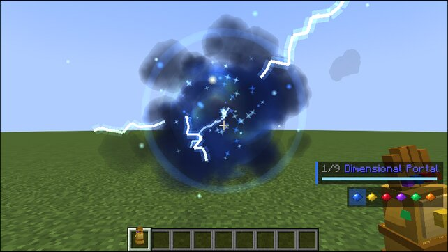 | 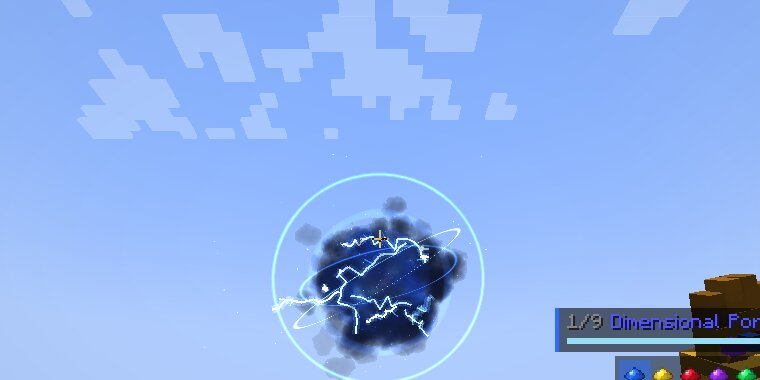 | 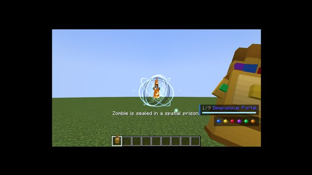 |

| Time Freeze | Temporal Echo | Time Fracture |
| --- | --- | --- |
| 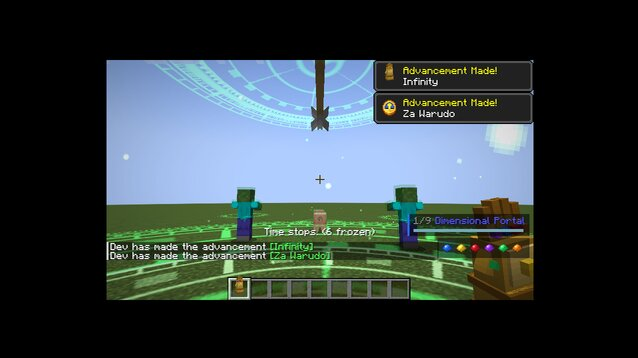 | 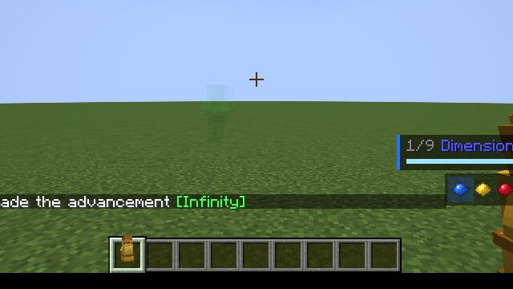 | 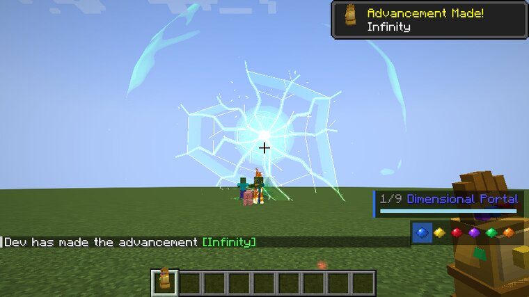 |

| Nexus console (live feed from a pig) | Neural link over a possessed zombie | Disconnection sequence |
| --- | --- | --- |
| 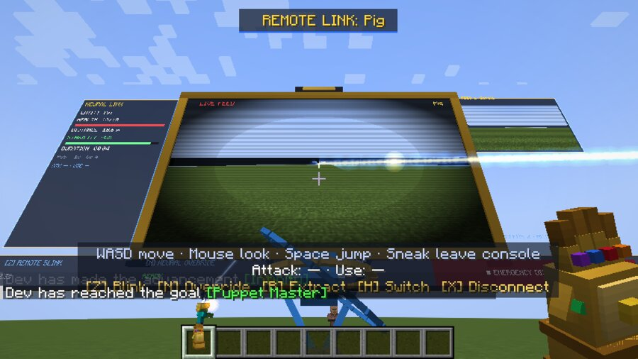 | 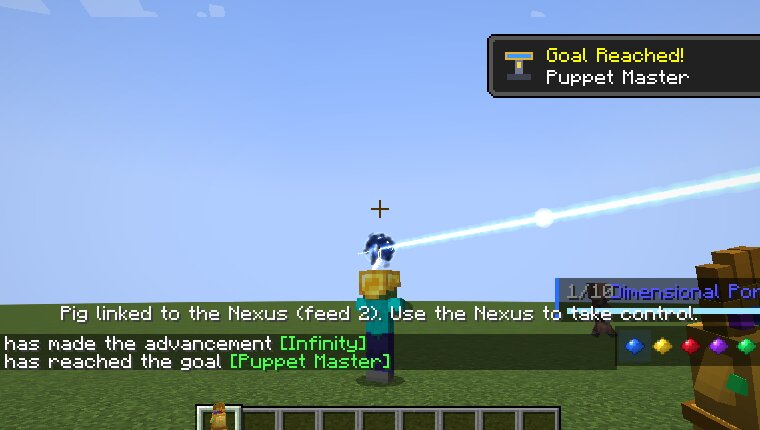 | 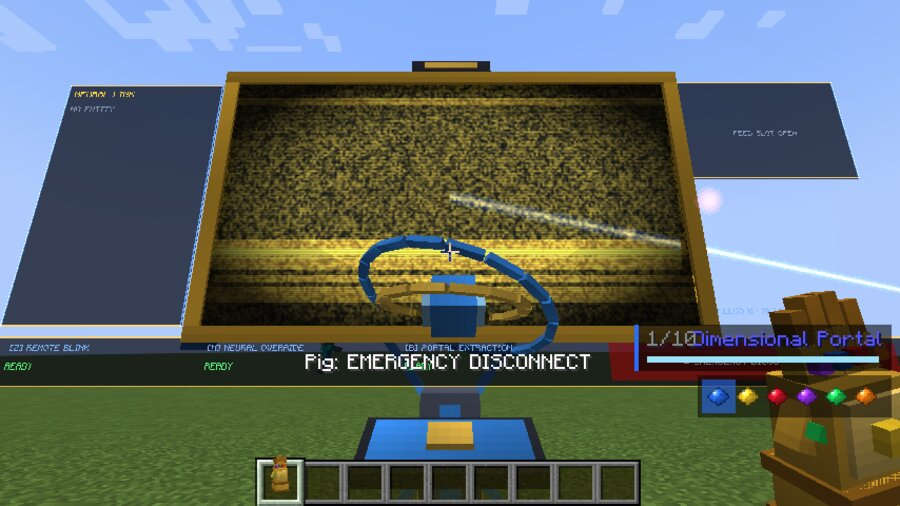 |

| Breach torn open on a pig | The white observation chamber | The control panel |
| --- | --- | --- |
| 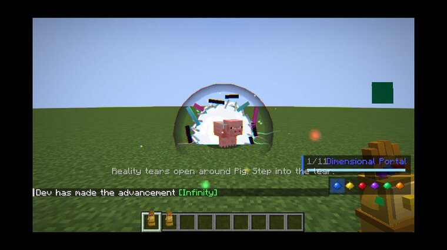 | 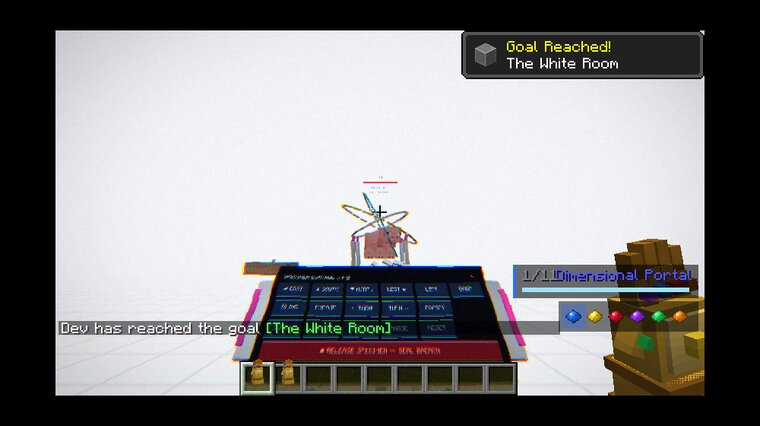 | 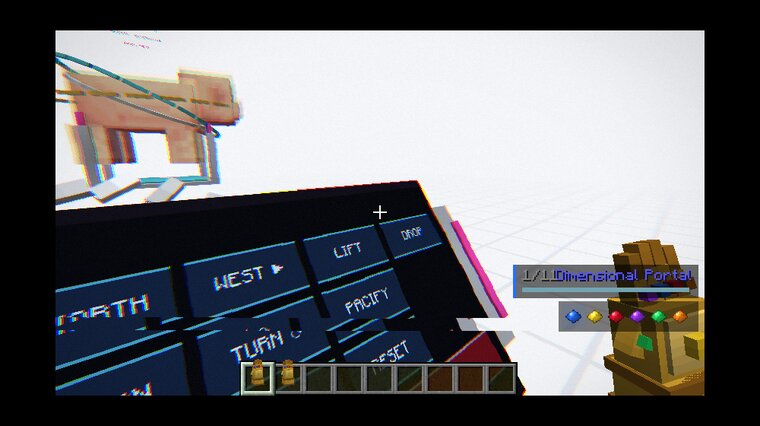 |

| The way back | The real pig afterwards: grown, frozen, exposed |
| --- | --- |
| 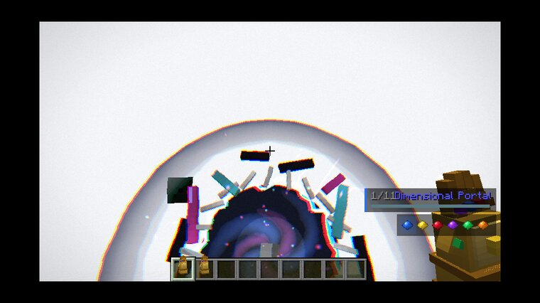 | 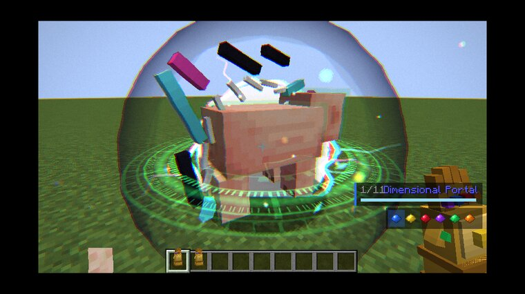 |

*Screenshots are from the headless test client (Mesa llvmpipe, default "Fancy" graphics).*

## Status

| Area | State |
| --- | --- |
| Gauntlet item: GeckoLib model, emissive stones, animations (idle, insert, charge, cast, snap, overload, per-stone activation) | done |
| Six stone items: animated GeckoLib gems | done (all six can be installed) |
| Ability framework: server-authoritative casting, per-ability configurable cooldowns, synced HUD | done |
| Cinematic VFX engine: ruptures, shockwaves, sphere pulses, implosions, beams, lightning, ground glyphs, links, dissolves, distortion lenses, particles | done |
| Camera system: shake, FOV push, flashes, full-screen dimensional transition (all configurable) | done |
| **Space Stone: all 9 abilities** | done |
| **Time Stone: all 9 abilities**, built on real tick-level time dilation | done |
| Progression: crafting, loot discovery, advancements, testing commands, GameTests | done for the Space, Time and Power Stones |
| Combination system (combos appear under each of their stones once all are installed) | done |
| **Mind + Space: Consciousness Nexus** remote possession with a real-time camera feed | done |
| **Mind + Space: Reality Breach**: walk through a rift into a white observation chamber and manipulate the real target | done |
| **Power Stone: all 9 abilities**, with cinematic finishers, hit reactions, death styles and a cinematic camera | done |
| Signature finisher system (shared framework); Cosmic Punch finisher | done; the other five stones' finishers are in progress |
| Mind, Reality and Soul solo abilities | not started; the stones install and render, but have no solo abilities yet |
| Other stone combinations, full-gauntlet ability set, the Snap sequence | not started |

The `snap` and `overload` gauntlet animations and the per-stone palettes are already in place for the later milestones.

## Space Stone abilities

Select with **V / C** (next/previous), switch stones with **G**, or hold **R** for the radial ability wheel. Cast by using the gauntlet.

| Ability | What it does |
| --- | --- |
| Dimensional Portal | Opens a spherical dimensional rupture where you aim. A second cast opens its twin and links the pair, in any dimension. Players, mobs, items and projectiles that enter come out of the twin with their momentum; players get the swirling transition overlay. Sneak-cast collapses all your ruptures. |
| Spatial Rift | Tears a whirlpool into the ground under the target. It drags creatures and loose items in, swallows them and drops them out of a rupture high above, then collapses with a pulse. |
| Blink | Dissolves you into spatial energy and moves you up to 12 blocks along your aim. It never places you inside blocks and ends with a shockwave. |
| Portal Barrage | Opens six orbiting portals that each lock onto a nearby enemy, fire three homing space bolts and close one by one. |
| Spatial Compression | Launches a sphere that pulls creatures, items and projectiles inward while it shrinks and brightens. It then detonates in a spatial shockwave. |
| Dimension Swap | Exchanges positions through paired ruptures. You can swap a creature with an anchored creature, with a marker (sneak-cast places one), or with yourself. |
| Cosmic Gateway | Charges, then tears an enormous ringed rupture into the sky above the battlefield, linked to a rupture in front of you. Anything sent through drops from the sky. |
| Spatial Prison | Suspends a creature inside six rotating portal rings. Its escape attempts are snapped back and show as strain on the rings. |
| Universal Teleportation | Gathers you and your allies (team players and your pets) into a great rupture and moves the group to your waypoint (sneak-cast sets it; works across dimensions) or to where you aim. |

## Time Stone abilities

Time manipulation is real, not a Slowness effect. Every affected entity gets a time scale, and its ticks are skipped
at that rate on the server and on every client. A frozen zombie keeps its pose, momentum and AI state and resumes
exactly where it stopped. An arrow in a time field flies at a quarter of its speed. Players move on their own client,
so they are slowed through movement attributes instead. Rewind, Echo and Loop use a recorded movement history.
Only position, rotation and velocity are ever restored, never health, inventories or blocks.

| Ability | What it does |
| --- | --- |
| Time Freeze | A green wave stops time around you (12 blocks by default). Creatures, projectiles and falling items hang motionless with clock rings and flickering afterimages, among suspended emerald motes, then resume with a pulse. |
| Time Slow | A ground field with a turning clock dial; everything inside except you and your allies runs at 25% speed. Stepping out restores normal time at once. |
| Time Acceleration | Speeds up your own time (movement, attack speed, mining, step height) with a trail of green afterimages of your own model. |
| Temporal Bubble | A great sphere, wrapped in rotating gear rings and orbiting clock dials, where time runs at 12%. It is placed so you stay outside it. |
| Temporal Echo | A green ghost of you, drawn with your actual player model, re-walks your last four seconds and pulls hostile mobs onto itself. |
| Rewind | Plays the aimed target's movement backwards (or everything hostile nearby) while its afterimages trail behind. Sneak-cast rewinds yourself. |
| Temporal Loop | A time anomaly on the ground. Creatures that enter it get snapped back to the moment they arrived every 2.5 seconds until they escape or the loop ends. |
| Chronological Barrier | A disc of clockwork rings in front of you. Incoming projectiles decelerate and hang suspended in front of it; cast again to send them all back. |
| Time Fracture | Charges, then shatters the air over the battlefield into a turning pane of cracked time. It pulses nearby creatures into near-stillness, shows afterimages of where they were, and implodes in a green flash. |

## Power Stone abilities

Every Power Stone ability has its own body pose, gauntlet animation (GeckoLib), sounds and effect vocabulary. Nothing is shared between two of them except the purple.

| Ability | What happens |
| --- | --- |
| **Power Beam** | The gauntlet trembles for a second as energy streams into it, then a coiling **helix beam** (white-hot core and two spiralling strands) erupts and can be swept across the field for 1.6 s, scorching cracks where it lands. **Finisher, Disintegration:** the first kill cuts to a slow-motion close-up as the victim burns away into ash and crystal shards, then detonates. |
| **Cosmic Punch** | Dash at the target and land one blow: **hit-stop** (the world freezes for 5 ticks), an inverted **impact frame** with a star of spikes and speed lines, a camera punch-in, then a vertical shockwave and the target is launched, tumbling, with a glowing trail. **Finisher, Execution** (target under 35 % health): a low side angle with a dutch tilt, time slows to a crawl as it flies, the head may come off, and it explodes where it falls. |
| **Groundbreaker** | Leap, hang at the apex, hammer down. **Three rings** roll out 6 ticks apart: the inner ring pops enemies helplessly into the air, the middle one tumbles them, the outer one bowls them over. Glowing **fissures** race across the ground and **real block chunks** of the ground you stand on are thrown up. |
| **Energy Nova** | You rise three blocks, arms spread, while energy gathers and every creature nearby drifts up in **slow motion**. The camera orbits you. Then a sphere of force releases with a **chromatic-aberration** spike and a white flash, hurling everything away. |
| **Cosmic Artillery** | Six GeckoLib orbs spiral up and hang overhead while **lock-on reticles** spin in on the nearest enemies in front of you, seen from a low upward camera. One by one they fall as screaming **meteors**, cratering the ground (or bursting mid-air if they catch a target airborne). |
| **Power Overload** | Ten seconds: every bare-handed or weapon hit lands with a shockwave, a recoil and a cleave; sprinting tears the ground with a wake of shockwaves; sparks crackle off your fist; when it ends it vents in a final burst. |
| **Gravity Impact** | A black singularity with an accretion disk sinks out of the sky over 2.5 s. Everything beneath it is lifted and held **suspended**, slowly turning, while lightning crawls between them and the core, until it touches down and **crushes** them flat. **Finisher, Crushing Singularity:** on a kill the camera pulls back as the core implodes and detonates under a smoke column. |
| **Cosmic Barrage** | Five orbs orbit you, each with its own detonation: **Cluster** (splits into five bomblets), **Chain** (lightning leaps between up to six victims), **Gravity** (becomes a collapsing well), **Lance** (pierces everything in a line) and **Shatter** (a nova of crystal shards). Cast to fire the next one, sneak-cast to fire them all. The cooldown starts once the last one is gone. |
| **Planetary Force** | Hold a swelling, ring-wrapped core for three seconds while the ground splits and lifts around you and the camera **pulls back** to a wide shot, then hurl it. Its impact unfolds in four stages: a blinding implosion, the main blast, a ring of secondary detonations and a towering mushroom of smoke. |

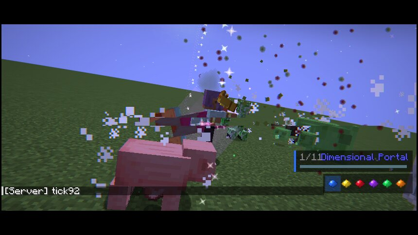
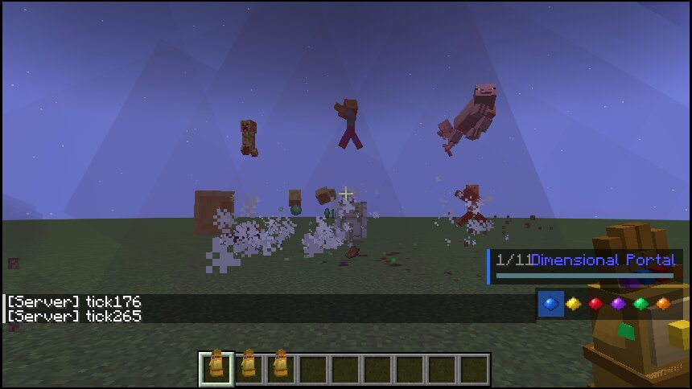
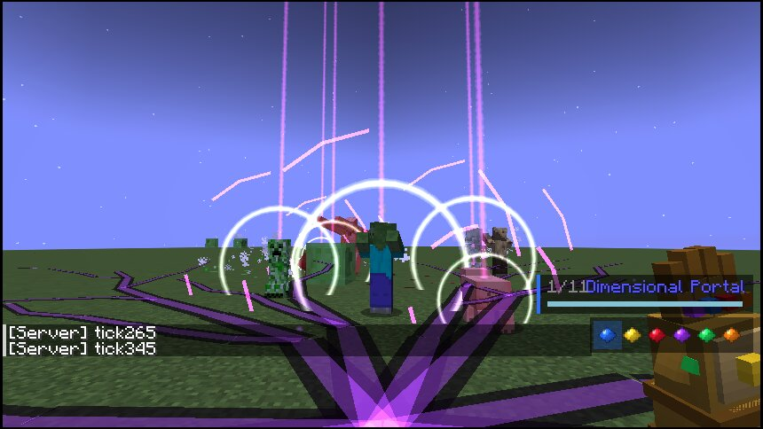
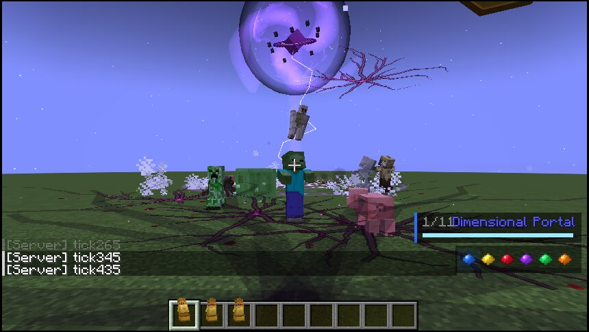
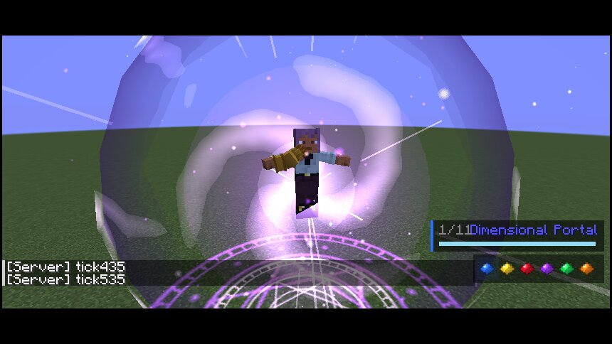
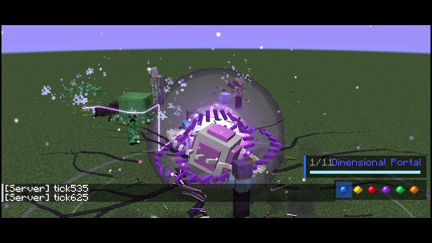
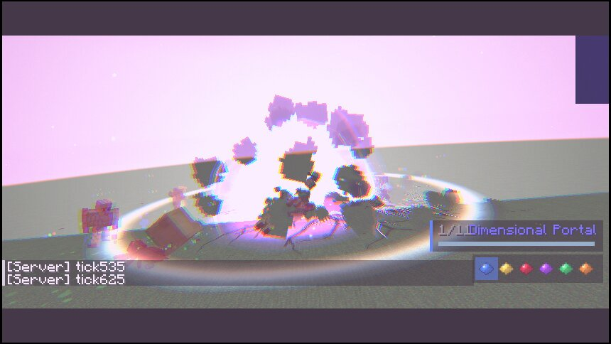
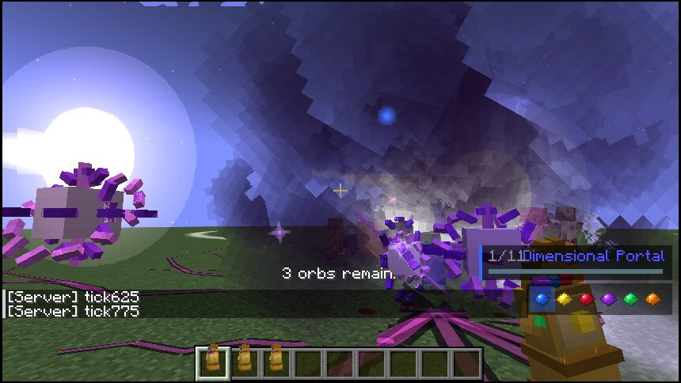

### Cinematic finishers

A weakened target (35 % health or less by default) is not just hit: the stone's **signature finisher** plays out in full.
The caster and target are locked into a choreographed sequence. The caster's real 3D model animates its whole body, the
camera cuts between directed shots, and the screen is graded in the stone's colour. The caster takes no damage
and the target cannot die early. If the caster disconnects, dies or changes dimension, or the target unloads, the
sequence stops and everything is released. Server options live under `finishers` (`enabled`, `healthThreshold`,
`onPlayers`).

**Cosmic Punch: execution** (5.6 s). The caster rocks back, then lunges in six ticks with a purple energy trail on the
arm. The gauntlet fist is driven through the target: a white then black impact frame, hit-stop, and energy bursting out
of its back. The target hangs frozen on the fist while it glows ever brighter pink. Light cracks across its body and
heartbeat pulses run through it, quickening, with the picture distorting more each beat. The camera slowly orbits,
then pushes in on its face. At critical mass it erupts in a pink-purple cosmic explosion with a shockwave. The caster
recoils and draws the arm back out of the dissolving energy. Each body type reacts differently: humanoids are impaled
and arch back, quadrupeds rear, slimes swell, spiders curl, flyers spin.

### Combat presentation

* **Per-creature impacts** (stylized, not photoreal): flesh sheds red droplets that splat on the ground, zombies dark blood and rotten chunks, skeletons bone shards and dust, wither skeletons black bone, slimes green goo, magma cubes molten droplets and embers, blazes/breezes/vexes embers, iron golems and shulkers metal sparks, endermen purple motes, spiders/silverfish/bees ichor, creepers gunpowder chunks and smoke. Set `impactStyle = ENERGY` in the client config for purple energy on everything.
* **Reactions** play on top of the creature's own animation: stagger, recoil, suspension, tumbling and crushing.
* **Death styles**: ragdoll tumble, crushed flat, disintegrated into ash, and the execution snap.
* **Dismemberment** (non-graphic): finishers can knock the head off zombies, husks, drowned, skeletons, strays, wither skeletons, creepers, piglins and players. The head pops off whole as a tumbling skull and bounces away; the body is drawn headless. Turn it off with the server option `dismemberment`.
* **Hit-stop and slow motion** use the Time Stone's tick dilation without its clock-ring overlay (server option `slowMotion`).
* **Cinematic camera**: finishers take the camera for a moment, easing in from your view and back, avoiding terrain, with letterbox bars and the HUD hidden. Clients can turn it off (`cinematicCamera`).
* **Player poses**: a custom `HumanoidModel.ArmPose` (added through NeoForge's enum extension) drives each ability's body animation in third person, and the first-person gauntlet hand follows the same motion.
* **Terrain damage** from impacts is off by default (server option `terrainDamage`, which also requires `mobGriefing`). Debris is otherwise purely visual.

## Mind + Space: the Consciousness Nexus

The player never becomes the creature. They stay in their own body at a control station and operate the creature
remotely, watching a live camera feed on the station's holographic screen.

1. **Build and bind a Nexus.** Craft it (tinted glass over ender eyes and an observer, on gold blocks around a
   lodestone), place it, and use it once to bind it to yourself.
2. **Link a creature.** With the Mind and Space Stones installed, select *Remote Consciousness* (it appears under both
   stones) and cast it at a mob within 64 blocks of the Nexus. A miniature blue-black rupture opens over its head,
   golden neural tendrils reach into it, its eyes glow yellow, and a blue-and-gold stream runs from the rupture to
   the Nexus. The station powers on (the screen opens like an old CRT) and the creature's own goals are suspended.
3. **Take the controls.** Use the Nexus: you are placed at the console facing the screen. WASD moves the creature,
   the mouse turns its head, Space jumps, Sprint runs, Attack is its natural attack and Use its special action.
   Your own body and view stay at the station.

**The live screen is a real render.** Every frame the level is rendered a second time from the creature's eyes into
an offscreen framebuffer: the main render target and camera entity are swapped through an access transformer. The
screen samples that framebuffer, so it shows exactly what the creature sees. The operator's feed renders every
frame, other feeds every third or tenth frame at 512 px wide, and only for stations within 40 blocks.

**Interface.** The screen shows a LIVE FEED marker, the creature's name and a reticle. Holographic panels around it
show health, distance, connection stability, link duration and coordinates, the multi-feed monitors, ability status,
and the emergency disconnect control. Stability drops with distance; below 30% the picture fills with golden
interference, the station shakes, warnings blink and an alarm sounds. Past the range limit the link breaks.

| Creature | Attack | Special (Use) |
| --- | --- | --- |
| Zombie | melee | groan |
| Skeleton | draws and shoots along the view | — |
| Spider | melee | leap (climbs walls by walking into them) |
| Creeper | detonate (configurable) | detonate |
| Enderman | melee | teleport to where it looks |
| Iron Golem | heavy smash (launches the target) | ground slam (knocks everything nearby away) |
| Villager | — | operates doors, trapdoors, gates, buttons, levers and bells in front of it |
| Other mobs | melee if they have an attack | — |

| Key (default) | Action |
| --- | --- |
| Z | **Remote Blink**: Space-teleports the creature 8 blocks along its view |
| N | **Neural Override**: speed, strength, jump and resistance for 10 s (costs stability) |
| B | **Portal Extraction**: rupture-transports the creature to the Nexus and ends its link |
| H | **Entity Switching**: cycles the active creature (up to 3 linked: multi-feed) |
| X | **Emergency Recall**: severs every link at once |
| Sneak | leave the console (links stay up) |

**Disconnecting** (by key, death, unloading, range, expiry or extraction) plays the full sequence: golden
interference floods the picture, the signal is lost to static showing the reason, the rupture over the creature's
head implodes and the beam fades, the screen collapses to a line, and the station returns to standby. The
creature's own AI, movement control and targeting are restored exactly as they were. Possessed mobs never despawn.
Everything is decided on the server: clients only send movement, view and button state, which the server validates
(the operator must be at their own console, within 6 blocks).

## Mind + Space: Reality Breach

A forbidden reality-manipulation machine disguised as a spell. Nothing here is a GUI: the rift, the room, the
specimen and the control panel are all physical objects in the world.

1. **Manifestation.** Cast *Reality Breach* (it appears under both Mind and Space) at a creature. Reality tears
   open on it: a ring of jagged GeckoLib-animated shards snaps together around it, the aperture shows the white
   of the room beyond, and the torn edge is drawn in separated red, cyan and white for in-world chromatic
   aberration. Cracks run out into the surrounding space and a lens darkens what is behind it. The tear clings
   to the creature wherever it goes.
2. **Entering.** Walk into the tear. Only the caster passes. You dissolve, the screen tears, and you arrive in
   your own **observation chamber**: a separate dimension holding a featureless, glowing white lab whose edges
   dissolve into white fog, so it seems to go on forever. Every player has their own room, 1024 blocks from the
   next.
3. **The specimen.** A GeckoLib containment unit (pylons and three gimballed rings) holds a live mirror of the
   target, drawn with its real model. It shows the target's pose, head turning, walk cycle, size and age as they
   happen. Telemetry floats above it (name, health, scale, real coordinates and dimension, active manipulations).
   Beside it, a survey hologram shows a miniature of the blocks around the real target, refreshed every two
   seconds, with a tiny copy of the creature where it actually stands.
4. **The control panel.** A floating GeckoLib console deploys in front of you. Aim at a holographic button on
   its face and click. It's a real ray test against the panel's plane, re-validated on the server.

| Group | Controls (all act on the real creature in its own world) |
| --- | --- |
| Movement | ◀ EAST · ▲ SOUTH · ▼ NORTH · WEST ▶ (2-block shifts, matching what you see from the console), LIFT (levitate), DROP |
| Vision and perspective | BLIND (blindness, darkness, and its follow range cut by 90%: it loses its targets), EXPOSE (glowing), ⟲ TURN / TURN ⟳ (45°), PACIFY (no targeting) |
| Dimension | SHRINK / GROW (five sizes from ×0.3 to ×2.4, through the scale attribute), FREEZE (Time Stone tick freeze), PHASE (invisibility), RESET |
| System | RELEASE: revert everything and seal the breach |

Toggles light up while they are active, and the specimen shows them too (green time-ghost when frozen, pale
outline when phased, aura when exposed).

5. **Reality distortion.** A full-screen post shader interferes with the image: rippling space radiating from
   the rift's on-screen position, slice tearing, RGB separation, grain, corrupted inverted blocks, and exposure and
   colour flickers. It runs constantly but subtly in the chamber, with random bursts (each with a digital glitch
   sound and a flicker of the room's "white" light). Outside, it swells as you approach an open rift, and every
   crossing tears the picture. The specimen itself splits into red and cyan copies during glitches. Strength
   follows the VFX quality setting.
6. **Leaving.** Walk into the return rift behind the arrival point to go back to where you entered. The breach
   stays open, so you can go back in, until you seal it.

**Cleanup.** Sealing the breach (RELEASE, re-casting, logging out, the 10-minute limit) reverts every
manipulation on the real creature, removes the room's objects and brings you home if you are inside. If the
creature dies or unloads, the specimen shatters with "SPECIMEN LOST", the tear closes, and the return rift stays
until you use it. If you log back in inside a chamber without a breach, you are sent back to where you entered.
Players cannot be breached unless the server allows offensive abilities against players.

> **Note:** like every mod that adds a dimension, the first load of a world shows Minecraft's "experimental
> settings" warning once. Confirm it and NeoForge remembers your choice for that world.

## Getting the gauntlet (survival)

* **Gauntlet:** crafted from 6 gold blocks, a netherite ingot and a nether star (shaped: ` N ` / `GUG` / `GGG`).
* **Space Stone (Tesseract):** found in End City treasure chests (20%), stronghold libraries (8%) and ancient cities (4%).
* **Time Stone (Eye of Agamotto):** found in jungle temples (25%), woodland mansions (15%) and desert pyramids (6%).
* **Installing a stone:** right-click the stone onto the gauntlet in your inventory (bundle-style), or sneak-use the gauntlet with the stone in your off hand. Right-click the gauntlet with an empty cursor to take the selected stone back out.
* **Advancements:** the "Infinity" tab includes Infinity, The Tesseract, A Hole in Reality, Folded Space, Between Worlds, Master of Space, The Eye of Agamotto, Za Warudo, Puppet Master, The White Room, Dormammu I've Come to Bargain, Master of Time and I Am Inevitable.

## Testing commands (permission level 2)

```
/gauntlet give full|empty|stone <stone>
/gauntlet cast <ability id>          # ignores cooldowns; uses the held gauntlet or a temporary full one
/gauntlet cooldowns reset [targets]
/gauntlet portals list|clear
/gauntlet vfx <type>                 # preview any VFX primitive in front of you
/gauntlet abilities
/gauntlet breach traverse            # pass through your breach (in or out) without walking into the tear
/gauntlet breach press <control>     # press a chamber panel button
/gauntlet nexus bind|control         # bind / take the controls of the nearest Nexus (within 8 blocks)
/gauntlet nexus action <leave|disconnect|switch|blink|override|extract>
```

## Configuration

* **Server** (`serverconfig/infinitygauntlet-server.toml`, per world): portal size and duration, pair limit, cross-dimension linking, what portals may transport, all damage values, gateway height/size, group-teleport radius/range, every Time Stone strength, radius and duration (freeze, slow and bubble time scales, rewind history length, loop period...), possession range, link duration, feed count, creeper detonation and Neural Override length, PvP (`offensiveAbilitiesAffectPlayers`, off by default), a global cooldown multiplier and every ability's cooldown.
* **Server, Power Stone**: `damageMultiplier`, `terrainDamage` (off), `dismemberment` (on), `slowMotion` (on).
* **Client** (`config/infinitygauntlet-client.toml`): Power Stone `impactStyle` (`VISCERAL` or `ENERGY`) and `cinematicCamera`; VFX quality (`LOW`…`ULTRA`, scales particle and smoke density), effect draw distance, camera effects on/off, shake intensity, screen flashes, portal transition overlay and the HUD.

No ability edits terrain, unless you enable the Power Stone's `terrainDamage` server option.

## Architecture

```
ability/        Ability base, CastResult, AbilityCaster (the single cast path), per-player data, target rules
ability/space/  the nine Space Stone abilities
ability/time/   the nine Time Stone abilities
ability/power/  the nine Power Stone abilities
power/          CombatFx (strike, hit-stop, slow motion, reactions, death styles, decapitation), PowerFx, PowerOverload
entity/power/   GeckoLib orb, gravity singularity and planetary core entities; severed heads
time/           TimeManager (tick dilation), EntityHistory (movement recording), RewindController
breach/         Reality Breach: chamber dimension and cells, rift/panel/specimen entities, PanelLayout (shared hit test), BreachManager
nexus/          Consciousness Nexus block + block entity, PossessionManager (sessions), RemoteMoveControl, ControlProfiles
ability/combo/  combination abilities (Remote Consciousness)
entity/         RupturePortalEntity + PortalNetwork (SavedData links, survive unloads/restarts/dimensions),
                TimedEffectEntity base, rift/compression/prison/barrage-portal/bolt entities
vfx/            server API (Vfx) and the VfxType primitives; EnergyParticleOptions
network/        payloads; all sends skip connections without the mod's channels (fake/test players)
client/breach/  RealityDistortion (post shader, fog, glitches), rift/panel/specimen renderers, survey hologram, panel interaction
client/nexus/   FeedRenderer (offscreen camera feeds), NexusRenderer (screen + panels), NexusLinkRenderer, operator client + HUD
client/time/    ClientTime (client tick dilation), ClientHistory, Afterimages (ghost models), TimeOverlay
client/vfx/     render types, geometry builders (VfxDraw), RuptureDraw, ClientVfxManager, CameraEffects
client/render/  entity renderers and the GeckoLib item renderers
client/gui/     ability HUD, screen effects layer, ability wheel
client/power/   CombatClient (materials, reactions, deaths), CinematicCamera, PowerPoses + PowerArmPose, entity renderers
gametest/       server GameTests (arena structure generated by tools/generate_test_structures.py)
```

Gameplay is decided on the server; clients receive only what they need to draw (`VfxPayload`, `CameraPayload`, `TransitionPayload`). The rupture's volumetric look comes from layered geometry: a refraction haze, a rear shell of smoke puffs, an additive core with counter-rotating swirls, a front shell with outward-billowing tendrils, lightning arcs, and a rim light. The smoke puffs come from one 2×2 atlas, so each rupture's smoke is a single depth-sorted batch. Effect cost scales with the client quality setting. The mod uses no custom shaders; every effect is built from geometry and particles, so it works with or without shader packs.

All textures, GeckoLib geometry/animations and sounds are generated procedurally by `tools/generate_assets.py` (numpy, Pillow and ffmpeg with libvorbis), and the output is committed.

## Building and running

Requires JDK 21.

```bash
./gradlew build                 # jar in build/libs
./gradlew runClient             # dev client
./gradlew runClient -PquickPlayWorld=<save>   # boot straight into a singleplayer world
./gradlew runGameTestServer     # server GameTests (24 tests)
```

GameTests run in a world with only the vanilla flat-preset dimensions (the GameTest server does not load datapack
dimensions), so the breach test checks rift behaviour and the graceful no-chamber path there. It runs the full
enter, manipulate and leave loop whenever the chamber dimension is present.
