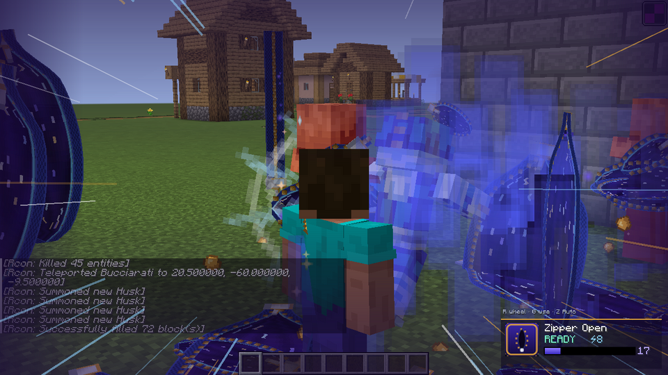
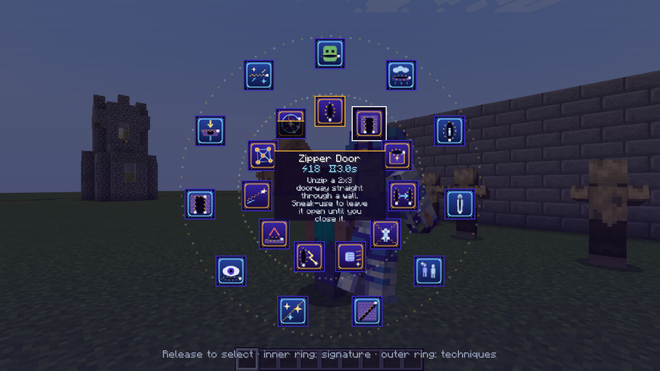

# Sticky Fingers — zipper Stand mod

A NeoForge **1.21.1** mod (Java 21) with **GeckoLib 4.7** animations. You get a 1:1 player-proportioned Stand and 22 zipper abilities that open, close, separate, store, traverse and manipulate the world.




## Build / run

```bash
./gradlew build        # -> build/libs/stickyfingers-1.0.0.jar (needs GeckoLib 4.7.7+ for NeoForge 1.21.1 in the mods folder)
./gradlew runClient    # dev client
./gradlew runServer    # dev server
```

## Controls (rebindable under *Sticky Fingers*)

| Key | Action |
| --- | --- |
| **V** | Summon / dismiss the Stand |
| **R** (hold) | Ability wheel. The inner ring holds the 11 signature abilities and the outer ring the 11 techniques. Release over a slot to select it. |
| **G** | Use the selected ability. **Sneak + G** while aiming at one of your zippers closes it; for Door it means "leave open permanently". |
| **N** | Zipper Network screen |
| **Z** | Cycle zipper orientation: auto / horizontal / vertical / diagonal / anti-diagonal |
| *(unbound)* | Close all of your zippers |

By default every player has the Stand (`grantStandByDefault`). Otherwise use a **Stand Arrow** (creative Combat / Tools tabs) or `/stickyfingers grant <player>`.

## Abilities

| # | Ability | What it does |
| --- | --- | --- |
| 1 | Zipper Open | Unzips a 3-long seam into a block face (2 deep) that you can see and walk into. On a container it unzips the container open; on a door it opens the door. Aimed at a mob it unzips the mob; aimed at air it makes an aerial zipper. Closes automatically. |
| 2 | Zipper Door | 2×3 passage through a wall, up to 4 deep. Sneak-use makes it permanent until you close it. Several can be open at once. |
| 3 | Zipper Storage | 27-slot pocket dimension, persisted per player. Holds items, blocks, weapons and modded items. |
| 4 | Zipper Travel | Place A, then B. They link both ways and anything walking into one exits the other. |
| 5 | Zipper on Mob | Freezes the target. It jitters, stretches and shows open seams with void motes. No gore. Closing restores it. |
| 6 | Zipper Restraint | Zipper chains anchor the target to up to 4 nearby surfaces: immobile, full knockback resistance, slowness. |
| 7 | Zipper Punch | Fast Stand barrage (hits every 2 ticks, ignores i-frames), then a launching finisher with camera shake and impact rings. |
| 8 | Aerial Zipper | Unzips air into a floating 3×3 platform. It is also a portal endpoint. |
| 9 | Zipper Escape | Vanish into zipper space (invisible, untargetable, immune). Use again, or wait, to emerge at your exit zipper or where you left. |
| 10 | Zipper Body | Hitbox scaled down 45% so you slip through 1-block gaps, plus a configurable dodge chance with sidesteps. Parts of the body are hidden in alternation. Use again to cancel. |
| 11 | Zipper Decoy | Leaves a copy wearing your skin and pulls mob aggro onto it. You slip out of a zipper nearby, invisible. The decoy bursts into teeth when hit. |
| 12 | Zipper Trap | Hidden floor zipper (faint to you, near-invisible to others). Snaps shut on the first creature within `trap.activationRadius`. |
| 13 | Zipper Projectile | Thrown slider with a glowing trail. On a hit it unzips and marks the target; on a block it opens a seam. |
| 14 | Zipper Teleport | You're pulled into a zipper, the screen zips shut, and you burst out at the target. Target priority: the zipper you aim at → the marked projectile target → your exit zipper → the surface you aim at. |
| 15 | Zipper Slice | Splits a structure along your facing direction for its duration. |
| 16 | Zipper Combo | Six zippers ring the target, then a barrage while the ring opens and closes, warps through the ring, a slow-mo beat, a launching finisher, and every zipper closes. |
| 17 | Zipper Ambush | Hide in zipper space, then emerge behind the nearest enemy. |
| 18 | Zipper Wall | 3×4 passage up to 6 deep. |
| 19 | Zipper Floor | 2×2 shaft down (12 deep by default; never into lava) with slow falling. |
| 20 | Zipper Repair | Closes every nearby zipper of yours, stitches separated blocks back, and frees restrained targets. |
| 21 | Zipper Network | Every zipper has a unique `#ID`. The screen has a list plus a top-down radar with link lines; you can travel, set the default exit, open/shut, link/unlink and close. |
| 22 | **Zipper World** | Slam, then up to 600 seams (default 160) race over floors, walls, ceilings, the air and enemies. Everything opens, you warp between openings hitting each enemy from new directions, slow motion, a giant final impact, then everything closes and you return home. |

## Design notes

* **Server-authoritative and multiplayer-safe.** Clients only send "use ability X". The server validates cooldown, energy, range and `enabled`. Stand state is synced to its owner, and zippers and the Stand are synced entities. Every ability goes through `AbilityExecutor`.
* **No permanent world damage.** All block changes go through `SeparationManager`. It is persisted SavedData that stores the original block state (and block-entity NBT when `separateBlockEntities` is on), keyed to the owning zipper. Blocks are restored when the zipper closes, its timer ends, the server stops, or the world reloads. A restore never overwrites a block a player placed in the gap. Block-break events are fired first, so claim and protection mods can veto. Bedrock-like and very hard blocks (`maxBlockHardness`) are skipped. Zipper entities are never saved to disk.
* **Modular.** Add an ability by adding an `AbilityType` entry (its defaults seed the config) and a case in `Abilities.activate`. Cinematic abilities are `Scheduler.Sequence`s, which are cancelled cleanly on death or logout.
* **Config** (`stickyfingers-server.toml`, synced to clients): each ability has `enabled / cooldown / cost / range / duration`. Also energy max and regen, max zippers per player, portal cooldown, damage multiplier, dodge chance, trap radius and whether traps hit players, PvP effects, protection, and the Zipper World seam count. Client config: camera shake strength, screen effects, HUD, particle density.
* **Visuals.** Zippers are a procedural mesh: fabric tapes, interlocking teeth, a sliding pull tab, a lens-shaped directional opening, and an emissive starfield interior with a cyan rim. There are 6 custom particle types (spark, tumbling tooth, void mote, seam glow, impact ring, afterimage). Camera effects are shake, FOV punch, a full-screen zip transition, flash, slow-mo letterbox and vignette, and speed lines. 20 custom synthesized sounds have subtitles.
* **Stand.** `geo/entity/sticky_fingers.geo.json` uses vanilla player-skin box UVs (64×64, with overlay layers), so the supplied skin maps 1:1. Animations: idle, summon, dismiss, barrage, heavy punch, slam, cast and unzip. The glow mask makes the eyes and gold zipper motifs emissive.
* **Admin / map making.** `/stickyfingers grant|revoke|energy|resetcooldowns|cast <player> <ability> [alt]|restoreworld`.

Asset generators (textures, icons, sounds) were procedural. Swap any PNG/OGG under `src/main/resources/assets/stickyfingers/` to restyle.
